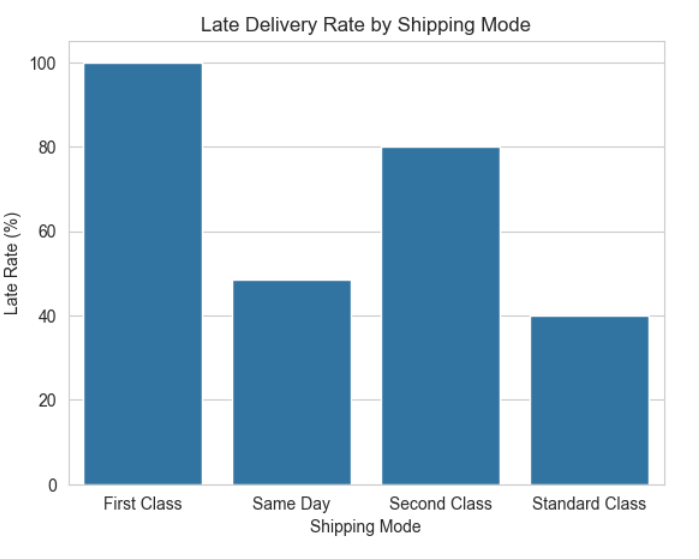
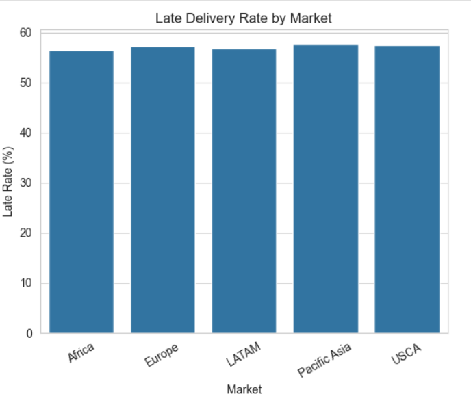
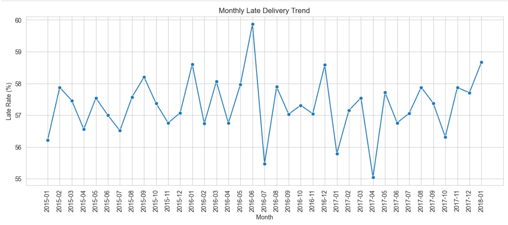
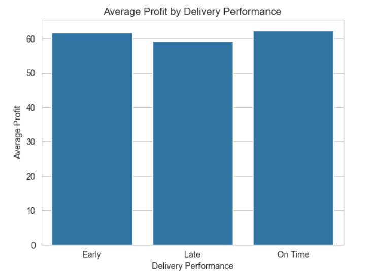

# Supply Chain Delivery Performance & Profitability Analysis

## Project Overview

This project focuses on analysing supply chain delivery performance and order profitability using Python and Exploratory Data Analysis (EDA).

The objective is to investigate delivery delays across different shipping modes, markets, and regions, identify monthly delivery trends, and understand how delivery performance relates to order profitability.

The analysis uses historical supply chain data to identify operational patterns, uncover potential problem areas, and generate meaningful business insights.

**Business Question:**

How does delivery performance vary across shipping modes, markets, and regions, and what relationship does it have with order profitability?

---

## Business Objectives

The project aims to answer the following business questions:

1. What proportion of orders are delivered late, on time, and early?
2. Which shipping modes experience the highest late-delivery rates?
3. How does delivery performance vary across different markets?
4. Which geographical regions experience more delivery delays?
5. Are there noticeable monthly trends in late deliveries?
6. Does order profitability differ between early, on-time, and late deliveries?
7. Which operational areas may require further investigation?

---

## Dataset

**Dataset:** DataCo Supply Chain Dataset  
**File:** `DataCoSupplyChainDataset.csv`

The dataset contains historical supply chain information, including:

- Order and shipping dates
- Shipping modes
- Market and regional details
- Product categories
- Order quantities and sales values
- Actual and scheduled shipping durations
- Order profitability information
- Order and delivery statuses

The dataset was loaded using Pandas with `latin1` encoding.

---

## Tools & Technologies

| Technology | Purpose |
|---|---|
| Python | Data analysis |
| Pandas | Data manipulation and cleaning |
| NumPy | Numerical operations |
| Matplotlib | Data visualization |
| Seaborn | Statistical visualization |
| Jupyter Notebook | Analysis environment |

---

## Project Workflow

### 1. Data Loading and Initial Exploration

- Loaded the dataset using Pandas.
- Examined dataset dimensions and data types.
- Reviewed descriptive statistics.
- Checked missing values and duplicate records.
- Analysed order statuses and shipping statuses.
- Examined unique order and item counts.

### 2. Data Cleaning and Preparation

- Converted order and shipping date columns into datetime format.
- Examined missing and inconsistent values.
- Calculated shipping durations.
- Compared actual shipping days against scheduled shipping days.
- Identified cancelled orders and invalid shipping-duration records.
- Prepared the data for delivery-performance analysis.

### 3. Delivery Performance Analysis

Created a delivery delay metric:

`Delay_Days = Days_for_shipping_real - Days_for_shipment_scheduled`

Orders were classified into three delivery categories:

- **Late:** Actual shipping duration exceeded scheduled shipping duration.
- **On Time:** Actual shipping duration matched scheduled shipping duration.
- **Early:** Actual shipping duration was lower than scheduled shipping duration.

Further analysis included:

- Overall late-delivery rate
- Average delivery delay
- Delivery delay severity
- Order-level delivery performance

### 4. Shipping Mode Analysis

Compared delivery performance across:

- First Class
- Same Day
- Second Class
- Standard Class

Evaluated:

- Number of orders
- Average actual shipping duration
- Average scheduled shipping duration
- Average delay
- Late-delivery rate

### 5. Market and Regional Analysis

Investigated geographical differences in delivery performance.

The analysis covered:

- Late-delivery rates across markets
- Regional delivery performance
- Average delay by region
- Order volumes across geographical segments

### 6. Monthly Trend Analysis

Analysed monthly late-delivery rates over the available period to identify fluctuations and potential changes in delivery performance over time.

### 7. Profitability Analysis

Explored how profitability varied across delivery categories.

Compared:

- Average order value
- Average order profit
- Median order profit
- Average profit margin
- Median profit margin

Orders were grouped into Early, On Time, and Late delivery categories.

### 8. Correlation Analysis

Used a correlation matrix and heatmap to examine relationships between selected numerical variables and identify potential associations.

---

## Key Findings

The analysis covered **62,897 orders** across five markets.

### 1. Overall Delivery Performance

- Late deliveries represented a significant proportion of analysed orders.
- Market-level late-delivery rates ranged from approximately 56.55% to 57.68%.
- Monthly late-delivery rates remained relatively consistent, generally between 55% and 60%.

### 2. Shipping Mode Performance

| Shipping Mode | Orders | Late Delivery Rate |
|---|---:|---:|
| First Class | 9,602 | 100.00% |
| Same Day | 3,407 | 48.37% |
| Second Class | 12,256 | 79.99% |
| Standard Class | 37,632 | 39.85% |

First Class recorded the highest late-delivery rate, followed by Second Class.

Standard Class recorded the lowest late-delivery rate among the four shipping modes.

These results should be interpreted in the context of the different scheduled shipping targets assigned to each shipping mode.

### 3. Market Performance

| Market | Late Delivery Rate |
|---|---:|
| Africa | 56.55% |
| Europe | 57.42% |
| LATAM | 56.90% |
| Pacific Asia | 57.68% |
| USCA | 57.52% |

Pacific Asia recorded the highest late-delivery rate, while Africa recorded the lowest.

The differences between markets were relatively small.

### 4. Regional Performance

- Central Africa recorded the highest regional late-delivery rate at approximately **60.04%**.
- Canada recorded the lowest at approximately **52.58%**.
- Some regions had considerably lower order volumes, so their rates should be interpreted cautiously.

### 5. Monthly Delivery Trends

- The highest monthly late-delivery rate was approximately **59.86% in June 2016**.
- The lowest was approximately **55.04% in April 2017**.
- No strong sustained improvement or deterioration was evident from the monthly rates alone.

### 6. Profitability Analysis

| Delivery Category | Average Order Profit | Average Profit Margin |
|---|---:|---:|
| Early | 61.82 | 12.36% |
| Late | 59.37 | 11.88% |
| On Time | 62.37 | 12.31% |

Key observations:

- On-time orders recorded the highest average order profit.
- Late orders recorded the lowest average order profit.
- Early orders recorded the highest average profit margin.
- The differences suggest an association between delivery performance and profitability, but do not establish a causal relationship.

*Note: Profitability figures are expressed in the dataset's recorded units. Profit aggregation should be validated to avoid double-counting order-level values.*

---

## Visualizations

The project includes the following visualizations to communicate the analytical findings.

### 1. Delivery Performance by Shipping Mode

Compares late-delivery rates across shipping modes and highlights differences in delivery performance.

### 2. Late Delivery Across Markets

Compares delivery performance across geographical markets.

### 3. Monthly Late Delivery Trend

Tracks monthly late-delivery rates to identify fluctuations over time.

### 4. Profitability by Delivery Category

Compares order